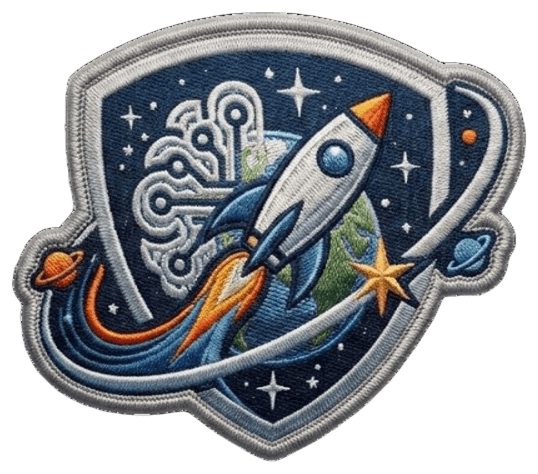
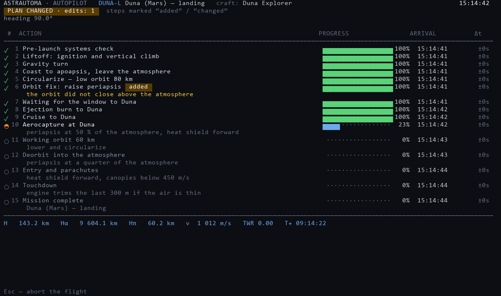
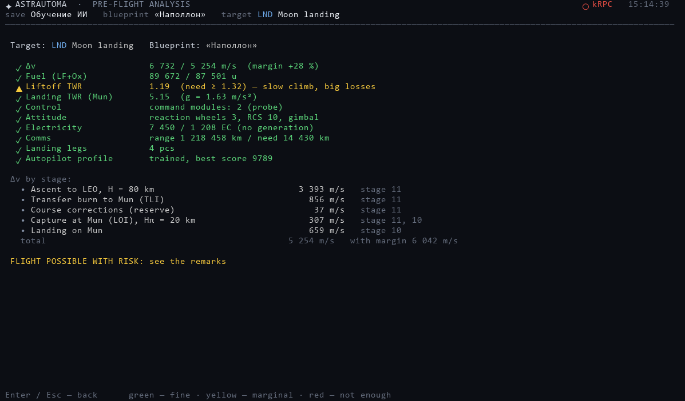
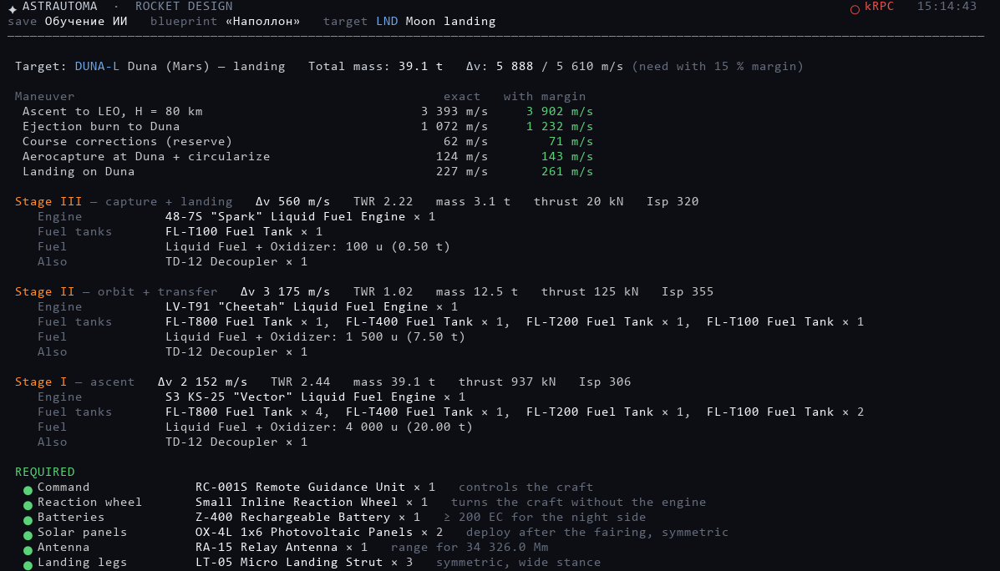

# ASTRAUTOMA

Autopilot for KSP 1.12. Plans the flight, checks your rocket and flies it.

[English](README.md) | [Русский](README.ru.md)

It's a separate program, not a mod. It connects to the game through kRPC, reads your save and the
craft on the pad, shows the plan and then flies it. Ascent, transfers, landing, rendezvous,
docking and coming back home.

## Install

1. KSP 1.12 + [kRPC](https://github.com/krpc/krpc/releases) in `GameData/kRPC`
2. [Python 3.10+](https://www.python.org/downloads/) (tick "Add python.exe to PATH")
3. Download `ASTRAUTOMA-vX.zip` from [releases](https://github.com/himsson/ASTRAUTOMA/releases/latest) and unpack it anywhere
4. Download the weights zip too (it's in a separate weights release). Without it there are no targets
5. In KSP load a save, open the kRPC window and press Start Server
6. Run `ASTRAUTOMA.bat`. It installs the missing python packages itself on the first run

If the weights zip is in Downloads or on the Desktop the app finds it and asks to install it.
Later you can manage them in Weights / Knowledge (A installs the newest, I imports a zip).

## What it can do

- checks the rocket before launch (dv, fuel, TWR, control, power, comms, legs) and marks
  everything green, yellow or red
- shows the whole flight plan with ETAs, and what it'll do if a step fails
- flies to every planet and moon in the stock system, uses aerobraking, chutes and gravity
  assists when they help
- brings any craft back home from wherever it is
- rendezvous and docking with any craft in orbit
- puts up relay sats first if the probe would lose signal
- designs a rocket from your parts and builds it in the VAB (learned from 497 real craft)
- notices a dead engine in about 1.5s and tries to save the crew
- reads rescaled systems, CommNet settings, career limits and modded parts

  
  

## Benchmarks

Same test for every weights version, runs without the game (scripts are in the
[training repo](https://github.com/himsson/ASTRAUTOMA-Training)).

| Version | Piloting | Design | Planning | Emergencies |
|---|---|---|---|---|
| 1.x | 100.0 % | 84.2 % | 97.8 % | 4.0 % |
| 2.0 | - | - | - | - |

- Piloting: 40 ascents in the hardest simulator, how many reach orbit
- Design: 190 projects, how many give a .craft the game can load
- Planning: 9216 missions, how often the route/window/assist is right
- Emergencies: crewed flights where something breaks on ascent, how many crews survive

Yeah 4% is bad. The 1.x weights never saw a failure in training, so that's the main thing for 2.0.
Weights 1.1, 1.2 and 1.3 have the same networks, that's why it's one row.

## FAQ

**Is it a mod?** No, only kRPC goes into GameData.

**Does it work with mods?** Yes, planets come from the running game and parts from your GameData.

**My rocket crashed.** Open an [issue](https://github.com/himsson/ASTRAUTOMA/issues) with a
screenshot of the flight table and the newest file from `logs/`.

## License

Source-available, not open source. You can read the code, use the program and fork it to send a
PR. Don't reupload it, publish forks as your own project or sell it. See [LICENSE](LICENSE).
