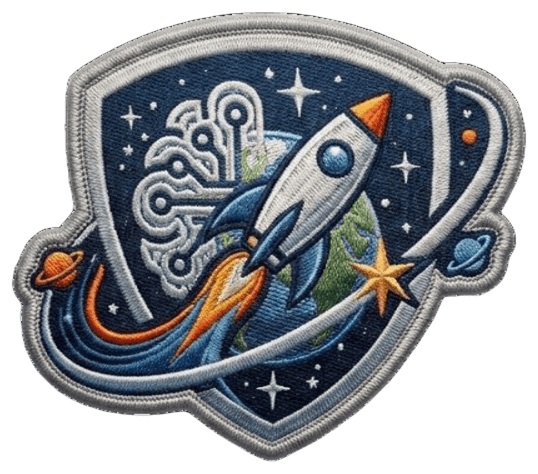
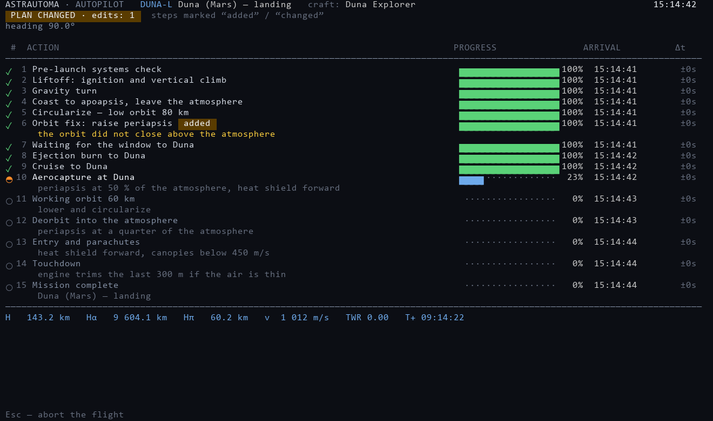
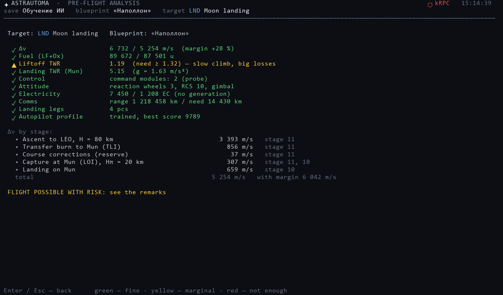
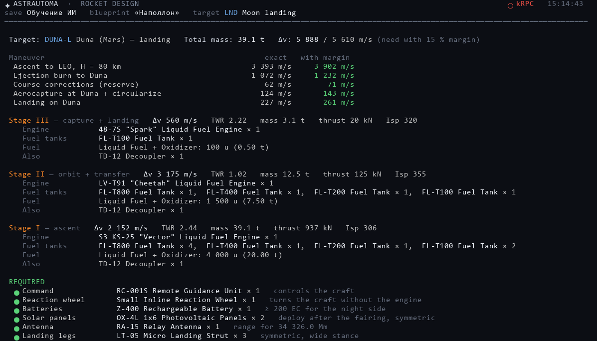

# ASTRAUTOMA

**Автопилот для Kerbal Space Program: планирует полёт, проверяет ракету и летит сам.**

**[🌐 Сайт](https://himsson.github.io/ASTRAUTOMA/)**

---

Отдельная программа, не мод. Говорит с игрой через kRPC, читает сохранение и ракету на столе,
показывает, что собирается делать, и делает: выведение, перелёт, торможение, посадку, сближение,
стыковку и возвращение.

## Установка

1. KSP 1.12 и мод [kRPC](https://github.com/krpc/krpc/releases) (папка `GameData/kRPC`).
2. [Python 3.10+](https://www.python.org/downloads/), галочка *Add python.exe to PATH*.
3. `ASTRAUTOMA-vX.zip` из [последнего релиза](https://github.com/himsson/ASTRAUTOMA/releases/latest), распаковать куда угодно.
4. Веса — см. ниже. Без них у программы нет целей полёта.
5. В KSP: загрузить сохранение, открыть окно kRPC, **Start Server**.
6. Запустить `ASTRAUTOMA.bat`. Недостающие пакеты Python ставятся сами при первом запуске.

## Веса

Обученная часть идёт отдельно: `ASTRAUTOMA-Weights-v*.zip` из
[релиза весов](https://github.com/himsson/ASTRAUTOMA/releases). Положите в *Загрузки* или на
рабочий стол — при первом запуске программа найдёт архив и предложит установить.

Дальше: **Веса / Знания → A** ставит самое свежее из всего, **I** импортирует архив, а отдельные
модули (профиль полёта, пилот, конструктор, математик, навигатор, знания) можно переключать между
версиями. Файлы весов читаются как обычные числа — спрятанный в них код не запустится.

## Что умеет

**До старта.** Читает ракету и выдаёт Δv, топливо, TWR,управляемость, питание, связь и
посадочные опоры — каждое зелёным, жёлтым или красным по отношению к тому, что нужно миссии.
Показывает план по шагам, а рядом — что будет сделано, если шаг не удастся: ветки считаются до
старта, потому что в воздухе считать их некогда.

**В полёте.** Окно пуска, азимут с поправкой на вращение планеты, гравитационный разворот,
скругление, фазовый угол перелёта по реальному положению тел. У каждого шага — время прибытия по
вашим часам и отставание или опережение. Когда что-то меняется, план переписывается, и правка
помечается.

**Куда летает.** Все планеты и луны стоковой системы: Мохо, Ив, Дюна, Дрес, Джул, Илу, от Минмуса
до Тайло. Аэрозахват там, где есть воздух, парашюты там, где они помогают, гравитационные манёвры,
когда пролёт мимо Ива или Джула дешевле прямого перелёта. **Возвращение домой** приводит аппарат
обратно откуда угодно.

**Сближение и стыковка.** Выберите любой аппарат на орбите любого тела: долетит, уравняет орбиты
и состыкуется.

**Связь.** Если зонд потеряет сигнал за планетой, программа скажет об этом и сначала доставит
ретрансляторы — сколько нужно орбите, каждый в свою точку.

**Проектирование и сборка.** Считает ракету из бюджета Δv, подбирает настоящие детали из вашей
GameData и собирает аппарат в VAB: ступени, разделители, ускорители, обтекатель, оснащение. План
ступеней следует тому, что люди строят на самом деле — выучено на 497 реальных аппаратах.

**Отказы.** Мёртвый двигатель распознаётся по показаниям тяги примерно за полторы секунды. Что
дальше — зависит от фазы: на выведении и посадке сразу исполняется заготовленная ветка, на орбите
даётся 30 секунд, чтобы вмешаться. Сначала люди, потом железо: спасение считает экипаж на борту и
пишет это в вердикт.

**Ваш мир.** Увеличенные системы, настройки CommNet и ограничения карьеры читаются из сохранения.
Детали модов подхватываются из GameData.

  
  

## Бенчмарки

Один и тот же экзамен для каждой версии весов, считается без игры скриптами
`tools/bench_designer.py` и `tools/benchmark.py` из
[репозитория обучения](https://github.com/himsson/ASTRAUTOMA-Training).

| Версия | Пилотирование | Проектирование | Планирование | Аварии |
|---|---|---|---|---|
| **1.x** | 100.0 % | 84.2 % | 97.8 % | 4.0 % |
| **2.0** | — | — | — | — |

**Пилотирование** — 40 взлётов в самом тяжёлом тренажёре, со стартового стола и на полной
жёсткости: сколько довели до устойчивой орбиты. **Проектирование** — 190 проектов (38 целей × 5
типов аппарата): сколько доведено до `.craft`, который принимает загрузчик игры.
**Планирование** — 9 216 миссий: как часто навигатор выбирает верные маршрут, окно и манёвр.
**Аварии** — пилотируемые полёты, где техника ломается на выведении: в скольких экипаж остался жив.

Релизы 1.1, 1.2 и 1.3 несут одни и те же сети, байт в байт — один прогон обучения, упакованный
трижды, — поэтому у них одна строка. Четыре процента в «Авариях» честные: этим весам отказов не показывали, а
пилот, который их не видел, уводит аппарат в землю — уцелевшие уцелели
случайно, а не потому, что справились. Ради этого и делается 2.0.

Математики в таблице нет. У Гомана, vis-viva, фазовых углов и Ламберта есть точные ответы, и
программа считает их формулами из `rocket_math`; нейроматематик, который лежит в весах, в полёте
не участвует.

## Вопросы

**Это мод?** Нет. В `GameData` идёт только kRPC.

**Работает с модами?** Да — данные планет берутся из запущенной игры, детали из вашей GameData.

**Ракета не долетела.** Откройте [issue](https://github.com/himsson/ASTRAUTOMA/issues) с таблицей
полёта и свежим файлом из `logs/`. Каждый полёт пишется целиком.

## Лицензия

[Открытый исходный код](LICENSE), но не open source. Читать код можно, пользоваться программой
можно, форкнуть ради pull request можно. Распространять, публиковать форк как свой проект и
продавать — нельзя.
