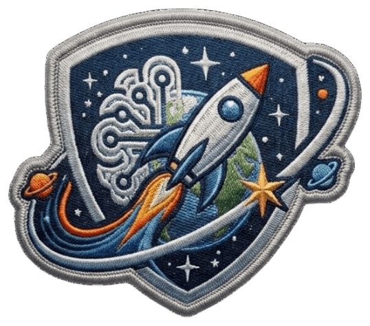
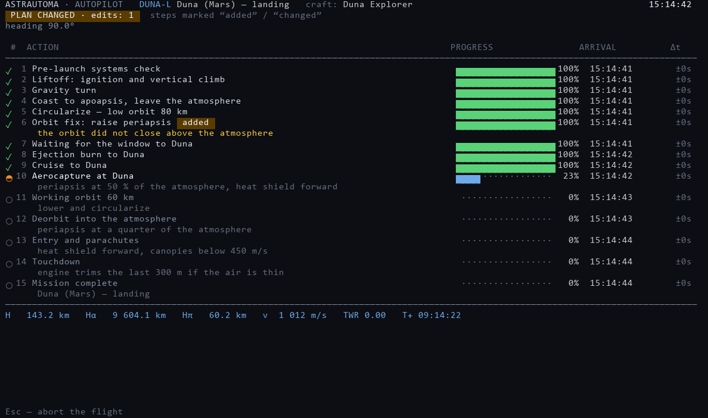
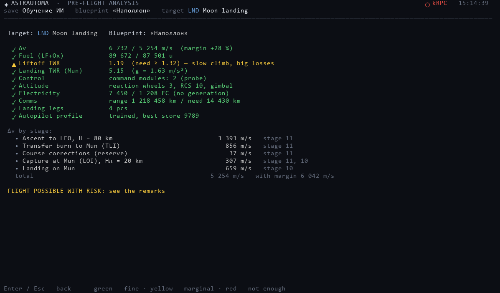
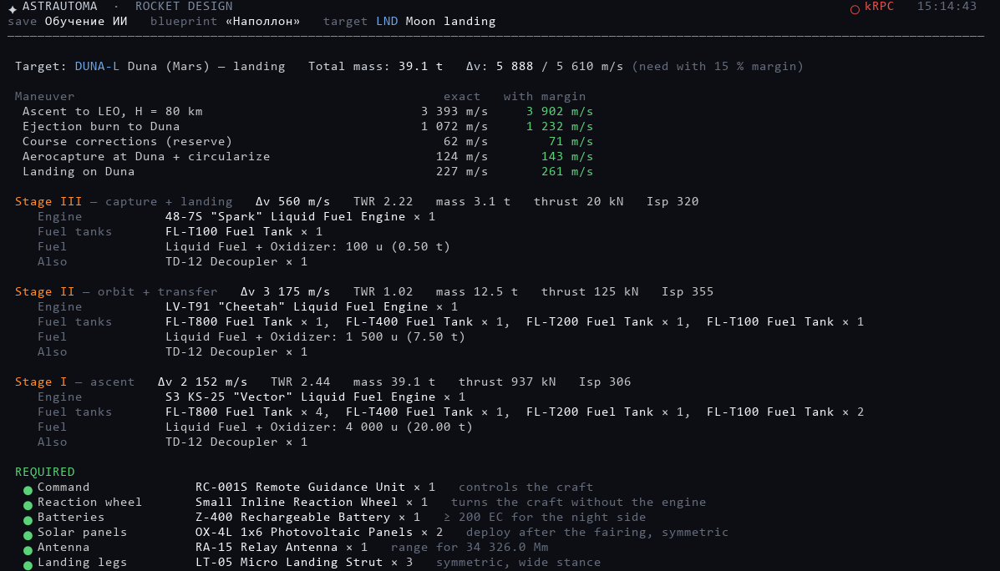

# ASTRAUTOMA

Автопилот для KSP 1.12. Сам планирует полёт, проверяет ракету и летит.

[English](README.md) | [Русский](README.ru.md)

Это отдельная программа, не мод. Подключается к игре через kRPC, читает сохранение и ракету на
столе, показывает план и летит по нему. Выведение, перелёты, посадка, сближение, стыковка и
возвращение домой.

## Установка

1. KSP 1.12 + [kRPC](https://github.com/krpc/krpc/releases) в `GameData/kRPC`
2. [Python 3.10+](https://www.python.org/downloads/) (галочка "Add python.exe to PATH")
3. Скачать `ASTRAUTOMA-vX.zip` из [релизов](https://github.com/himsson/ASTRAUTOMA/releases/latest) и распаковать куда угодно
4. Скачать ещё архив весов (он в отдельном релизе). Без них нет целей полёта
5. В KSP загрузить сохранение, открыть окно kRPC и нажать Start Server
6. Запустить `ASTRAUTOMA.bat`. При первом запуске он сам поставит нужные пакеты

Если архив весов лежит в Загрузках или на рабочем столе, программа сама его найдёт и предложит
поставить. Потом ими можно управлять в Веса / Знания (A ставит самые новые, I импортирует архив).

## Что умеет

- проверяет ракету до старта (dv, топливо, TWR, управление, питание, связь, опоры) и красит всё
  в зелёный, жёлтый или красный
- показывает весь план полёта со временем и что будет делать, если шаг не получится
- летает ко всем планетам и лунам стоковой системы, использует аэроторможение, парашюты и
  гравманёвры, когда это выгодно
- возвращает любой аппарат домой откуда угодно
- сближение и стыковка с любым аппаратом на орбите
- сначала выводит ретрансляторы, если зонд потеряет связь
- проектирует ракету из твоих деталей и собирает её в VAB (обучен на 497 настоящих аппаратах)
- замечает отказ двигателя примерно за 1.5 секунды и пытается спасти экипаж
- понимает увеличенные системы, настройки CommNet, ограничения карьеры и детали из модов

  
  

## Бенчмарки

Один и тот же тест для всех версий весов, гоняется без игры (скрипты в
[репозитории обучения](https://github.com/himsson/ASTRAUTOMA-Training)).

| Версия | Пилотирование | Проектирование | Планирование | Аварии |
|---|---|---|---|---|
| 1.x | 100.0 % | 84.2 % | 97.8 % | 4.0 % |
| 2.0 | - | - | - | - |

- Пилотирование: 40 взлётов в самом сложном тренажёре, сколько вышли на орбиту
- Проектирование: 190 проектов, сколько дали .craft, который игра загружает
- Планирование: 9216 миссий, как часто маршрут/окно/манёвр выбраны правильно
- Аварии: полёты с экипажем, где что-то ломается на выведении, сколько экипажей выжило

Да, 4% это плохо. Веса 1.x вообще не видели отказов при обучении, это главное для 2.0.
У весов 1.1, 1.2 и 1.3 одинаковые сети, поэтому одна строка.

## Вопросы

**Это мод?** Нет, в GameData ставится только kRPC.

**Работает с модами?** Да, планеты берутся из запущенной игры, детали из твоей GameData.

**Ракета разбилась.** Открой [issue](https://github.com/himsson/ASTRAUTOMA/issues) со скрином
таблицы полёта и свежим файлом из `logs/`.

## Лицензия

Код открыт для чтения, но это не open source. Можно читать код, пользоваться программой и
форкать, чтобы прислать PR. Нельзя перезаливать, выкладывать форк как свой проект и продавать.
Подробно в [LICENSE](LICENSE).
